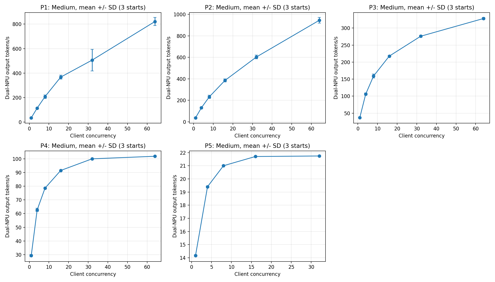
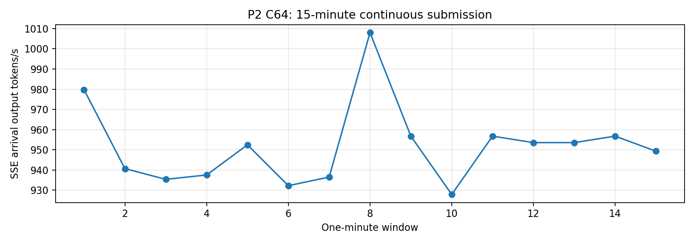

# B0 双卡 TP2 基线实验结果

测试队列已结束，含已记录的失败点。全部完成时间：北京时间 **2026-10-24 00:47:06**。
Medium 三轮90个单元：87成功，3个P5 C64预热读取超时；87个成功单元共5568条正式请求，正式请求失败0。失败单元没有正式计时结果，不能填0吞吐或算作192条正式失败。

## 配置与可比性

Qwen3.5-35B-A3B，双Ascend 910B2（原实验物理卡6/7），BF16，TP2/DP1/PP1，EP关闭；固定源码、权重、tokenizer及数据hash，MTP/APC/异步调度关闭。
Medium-v2：P1–P5每档64条，质量2406题。并发1/4/8/16/32/64，max-num-seqs64，max-num-batched-tokens8192，显存利用率0.85。输入/输出分别为512/128、1024/1024、8192/256、32768/256、131072/256。上下文上限4096/4096/16384/65536/262144。
每个上下文三次独立启动，第二轮逆序。预热/编译排除计时；Profiler单独采集。Small沿用4096预算筛选结果；不能把Small与Medium的差异全部归因于样本规模。Large历史批吞吐独立保留，不参与Medium均值。
容器实际限制8 CPU核配额、64GiB主存。API/Engine/TP0/TP1分别绑定24–31/32–39/96–119/48–71，内存交错NUMA2/4；一个API内核iou-sqp线程无法改亲和性并已记录。

## 三轮平均双卡输出吞吐

单位tokens/s；括号内为三轮样本标准差。每档64条短批包含排队和收尾效应。

| 档位 | C1 | C4 | C8 | C16 | C32 | C64 |
| --- | ---: | ---: | ---: | ---: | ---: | ---: |
| P1 | 34.90 (2.06) | 114.14 (3.28) | 207.77 (14.20) | 367.26 (15.82) | 505.95 (87.75) | 821.01 (32.86) |
| P2 | 37.49 (2.50) | 131.31 (6.76) | 232.40 (14.99) | 385.57 (14.38) | 603.60 (16.89) | 944.92 (26.46) |
| P3 | 37.10 (1.53) | 105.90 (3.08) | 159.05 (5.60) | 217.54 (2.05) | 275.90 (2.85) | 327.99 (2.99) |
| P4 | 29.41 (0.69) | 62.65 (1.21) | 78.54 (0.51) | 91.46 (0.25) | 99.97 (0.28) | 101.83 (0.31) |
| P5 | 14.17 (0.07) | 19.41 (0.06) | 21.00 (0.05) | 21.70 (0.02) | 21.74 (0.01) | 3轮预热超时 |

P2 C64/C1平均批吞吐比约25.2倍。P4 C32→64增益约1.9%；P5 C16→32增益约0.2%，已接近该配置的吞吐平台。P1 C32标准差较大，应视为波动点，不能从单轮作确定性优化结论。

## 已复用的Small筛选结果

Small预算4096、max-num-seqs32，以下是原筛选单轮结果，不能与Medium三轮均值作同配置收益比较。单位：双卡输出tokens/s。

| 档位 | C1 | C8 | C32 |
| --- | ---: | ---: | ---: |
| P1 | 40.36 | 226.37 | 538.75 |
| P2 | 46.29 | 267.20 | 647.89 |
| P3 | 39.37 | 136.21 | 207.29 |
| P4 | 28.99 | 59.72 | 68.39 |

## 低并发 Decode

P2 C1三轮均值：输出 **37.49 tokens/s**；TPOT **26.39 ms/token**；单请求耗时 **27.39 s**；TTFT **0.398 s**。

## Prefill、长上下文和延迟

下表均为三轮统计值的算术平均。P50/P95/P99是每轮分位数的平均，不冒充合并样本分位数。所有并发的完整延迟和请求/s在medium-aggregates.json。输入tokens/s用完整批次墙钟作分母，包含Decode，不能当纯Prefill算子吞吐。

| 档位/C | 输入tokens/s | 输出tokens/s | 请求/s | TTFT P50/P95/P99(s) | TPOT均值(ms) |
| --- | ---: | ---: | ---: | --- | ---: |
| P3/C1 | 1187.19 | 37.10 | 0.1449 | 0.511/0.521/0.524 | 25.09 |
| P3/C32 | 8828.80 | 275.90 | 1.0777 | 1.588/15.285/16.559 | 94.74 |
| P3/C64 | 10495.79 | 327.99 | 1.2812 | 17.270/31.941/33.223 | 122.01 |
| P4/C1 | 3764.98 | 29.41 | 0.1149 | 2.182/2.205/2.213 | 25.59 |
| P4/C32 | 12795.54 | 99.97 | 0.3905 | 3.403/63.485/68.993 | 238.10 |
| P4/C64 | 13034.20 | 101.83 | 0.3978 | 71.354/140.626/146.164 | 283.13 |
| P5/C1 | 7257.34 | 14.17 | 0.0554 | 11.302/11.365/11.384 | 26.50 |
| P5/C32 | 11132.19 | 21.74 | 0.0849 | 232.156/335.336/363.912 | 496.25 |

## 15分钟稳定性：P2 C64

持续提交900秒，含排空总时长960.31秒；完成896请求，失败0，抢占0。
15个一分钟窗口按实际SSE Token到达计数：平均 **951.80 tokens/s**，范围927.88–1008.00，窗口变异系数 **2.07%**。含排空总吞吐955.43 tokens/s。
全部完成请求TTFT P95/P99=1.940/3.921s；TPOT P95/P99=67.35/67.45ms/token。

## 显存、缓存和并发容量

独立内存RPC采集P2/P3低高并发以及P4/P5上下文。每卡参数32.30GiB，模型buffer0.125GiB，去重合计32.43GiB；缓存物理分配18.10GiB，916块。KV与DeltaNet状态按共享物理storage去重，不能把各逻辑视图再相加。图池约0.52GiB，日志峰值激活0.84GiB、non-torch0.44GiB；工作区未独立分离，不编造精确占用。
P4/P5诊断torch allocator最大allocated约51.40GiB、reserved约51.95GiB；与NPU总HBM统计口径不同。以下为5秒采样HBM观测峰值，含该单元预热；不能视为瞬时峰值。完整每单元结果在memory-observed.json。

| 档位 | 最大成功客户端并发（三轮共同） | 对应点实际运行请求数上限（5秒观测） | 卡6/7 HBM观测峰值(MiB) |
| --- | ---: | ---: | --- |
| P1 | 64 | 64 | 57397/57399 |
| P2 | 64 | 64 | 57403/57405 |
| P3 | 64 | 64 | 57379/57376 |
| P4 | 64 | 45 | 57373/57375 |
| P5 | 32 | 13 | 57366/57368 |

P5 C64三轮均因600秒socket-read超时在预热结束；无正式吞吐结果，也无直接证据断言OOM。最大成功客户端并发32不等于同时32请求驻留或运行；实际运行数见监控快照。

## Graph执行覆盖

配置FULL_AND_PIECEWISE、enforce_eager=False，捕获尺寸1/2/4/8/16/32/64；各服务日志观察到FULL、PIECEWISE、NONE路径。大Token prefill按已冻结覆盖规则走NONE，不声称全部图回放。Medium正式服务日志未匹配到显式recompile/fallback告警；这不能替代逐算子证明。请求block_size128经后端对齐后实际为2048，混合状态页有padding；所有配置按同一规则解释。

## 独立Profiler

P2/P3的C1和C64共4组，每组2个rank，均有离线解析结果。采集限24个引擎迭代，并非完整请求；Profiler耗时不能与正式吞吐混算。时间来自CANN step_trace_time.csv，单位ms，计算/通信可能重叠。

| 档位/C | rank | 计算 | 通信 | 未重叠通信 | overlap | HCCL Wait/Sync操作累计 | Free（不归因为同步等待） |
| --- | ---: | ---: | ---: | ---: | ---: | --- | ---: |
| profile-P2-C1 | 0 | 313.73 | 345.28 | 345.28 | 0.00 | 52.15/52.15 | 443.55 |
| profile-P2-C1 | 1 | 312.60 | 133.02 | 133.02 | 0.00 | 87.75/81.91 | 656.85 |
| profile-P2-C64 | 0 | 2967.69 | 1403.57 | 1403.57 | 0.00 | 53.98/53.98 | 1244.89 |
| profile-P2-C64 | 1 | 2970.92 | 1873.63 | 1873.63 | 0.00 | 26.72/22.90 | 771.61 |
| profile-P3-C1 | 0 | 549.43 | 236.70 | 236.70 | 0.00 | 65.20/65.20 | 318.82 |
| profile-P3-C1 | 1 | 553.79 | 216.12 | 216.12 | 0.00 | 26.40/20.52 | 335.08 |
| profile-P3-C64 | 0 | 7918.96 | 4146.54 | 4146.54 | 0.00 | 0.00/0.00 | 903.34 |
| profile-P3-C64 | 1 | 7917.16 | 3842.70 | 3842.70 | 0.00 | 0.00/0.00 | 1209.40 |

Wait/Sync为communication.json逐HCCL操作的原生字段累计，可能互有包含，不能彼此相加或当作完整请求壁钟。解析器报告部分memory record不完整，原采集也有RECORD状态停止提示；这限制了截断边界的解释。P3 C64的Wait/Sync字段全为0且通信归入Idle，不能将其解释为真实无同步开销。完整请求的同步等待归因仍缺乏可靠独立数值，Free不冒充同步等待。EP关闭，专家负载偏斜不适用。

## 质量与结论范围

Small：48/70=68.57%。Medium：1414/2406=58.77%，学科宏平均61.17%，无效输出1，服务失败0。Medium质量输出按原始ID从Large复用，无额外模型调用。固定零样本、关闭thinking、正常EOS、max_tokens16、严格单字母判分，不等同官方CoT成绩，也不能用不同样本集准确率比较性能配置退化。
本次仅完成B0 TP2基线及预算筛选；尚未运行W1–W7权重布局候选，因此不能证明当前TP2是最优布局。短输入仍随并发增加而提高吞吐，长输入吞吐较早达到平台，P5还有排队/超时约束。后续权重布局实验默认Small+Medium，并沿用冻结预算和图覆盖规则作同条件对照。

## 释放与证据

原实验结束时卡6/7无运行进程，HBM3433/3437MiB，已回到空闲基线。2026-10-26新SSH端口32037分配物理卡4/5，当前也无NPU进程、每卡3434MiB；这只是当前容器状态，不能将卡4/5身份回填历史测试。此次仅离线解析历史Profiler，没有重启模型或重跑基准。
本地原始证据：../final-audit/final-evidence.json、npu-samples.jsonl、metrics-samples.jsonl、stability/P2/requests.jsonl、medium-campaign.log；完整请求与Profiler原始数据保存在服务器 /root/opset-research/b0-weight-layout-20261023/。
数据hash、源码SHA、模型hash和来源映射在final-evidence.json的metadata中。不同规模不混合均值。